


 

 

I'm a systems engineer working on distributed systems, cloud, networking and DevOps. Most of my time goes into
**[Fortis](https://github.com/Fortis-OS/fortis-ecosystem)**: a Rust agent and PAM module on the laptop, a Kotlin app on
the phone, and a written security spec the code has to follow. Before that I built a city bus-tracking platform, and
most recently I was the founding software engineer intern at Kridtech. On the side I made my own KDE theme,
[Frost](https://github.com/ganeshak11/frost), which this page is dressed in. Mostly, I code for fun.

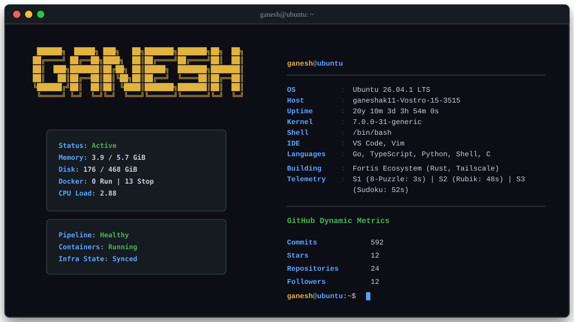

 

<a href="https://github.com/Fortis-OS/fortis-ecosystem"></a>

  <a href="https://github.com/Fortis-OS/fortis-ecosystem"><b>Repository</b></a> ·
  <a href="https://github.com/Fortis-OS/fortis-ecosystem/tree/main/docs">The spec</a> ·
  <a href="https://github.com/Fortis-OS/fortis-ecosystem/blob/main/docs/security/README.md">Security model</a> ·
  <a href="https://ganeshangadi.online/blog/fortis-ecosystem">The story</a>

 

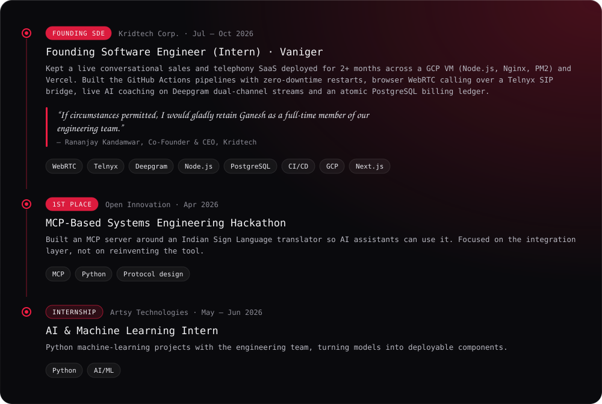

 

<a href="https://github.com/ganeshak11/frost">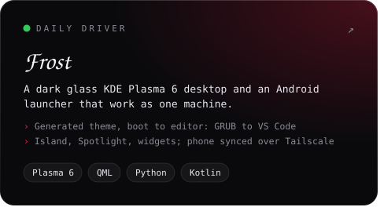</a><a href="https://ganeshangadi.online/blog/fortis-pseudo-os">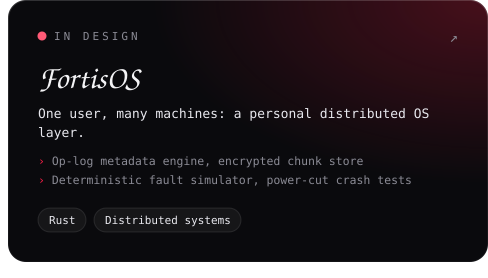</a><a href="https://github.com/Fortis-Tools">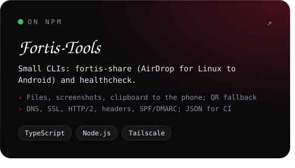</a><a href="https://github.com/ganeshak11/MY-suru-BUS">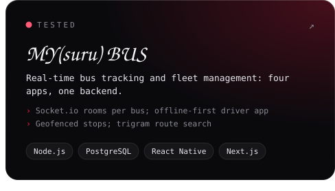</a><a href="https://github.com/ganeshak11/mechkeys">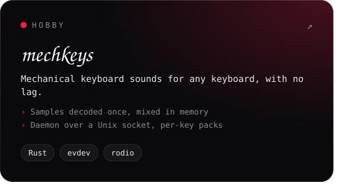</a><a href="https://github.com/ganeshak11/devcard-ganeshak11">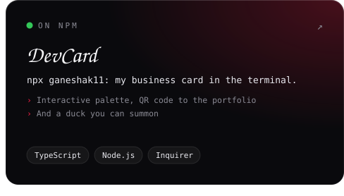</a><a href="https://github.com/Fortis-OS/fortis-observe">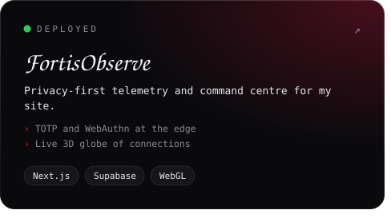</a><a href="https://github.com/Fortis-CI/Fortis-CI">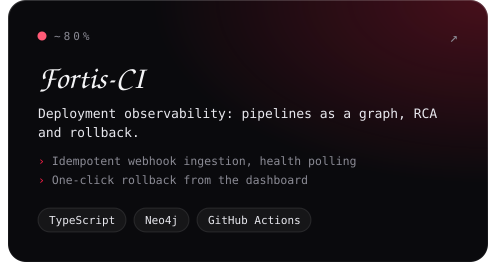</a>

 

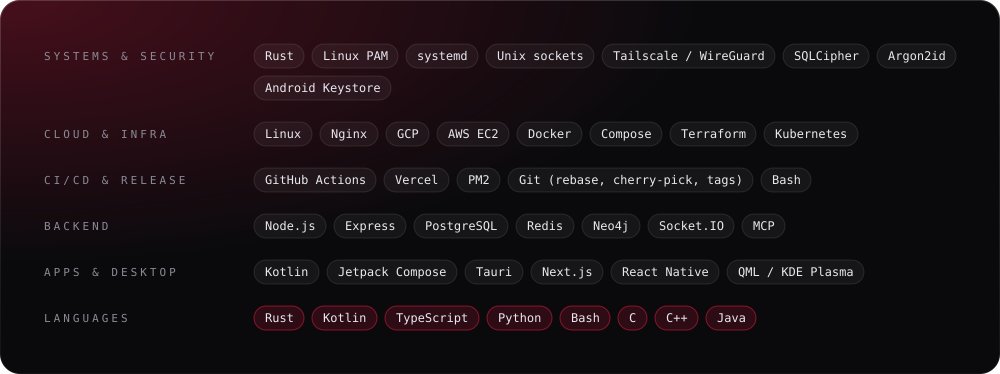

 

Everything is written from real projects, experiments or mistakes. **[All posts →](https://ganeshangadi.online/blog)**

| | |
|:---|:---|
| **Fortis** | [One User, Many Machines: The Question That Ruined My Sleep](https://ganeshangadi.online/blog/fortis-pseudo-os) |
| | [The Journey from Remote Shutdown Scripts to a Personal Ecosystem](https://ganeshangadi.online/blog/fortis-ecosystem) |
| **Hackathons** | [How I Accidentally Blocked the Entire Internet During a Hackathon Demo](https://ganeshangadi.online/blog/accidentally-blocked-the-internet) |
| | [How I Won My First Hackathon](https://ganeshangadi.online/blog/my-first-hackathon-win) |
| **Linux** | [I Didn't Switch to Linux. I Changed My Way of Living With Computers.](https://ganeshangadi.online/blog/why-linux) |
| | [How I Accidentally Became a Linux User](https://ganeshangadi.online/blog/how-i-became-a-linux-user) |
| | [Which Linux Distro to Choose: From Comfort to Chaos](https://ganeshangadi.online/blog/which-linux-distro-to-choose) |
| **DevOps Duel** | Eight head-to-heads: Compose vs Kubernetes, Actions vs Jenkins, VMs vs containers, IPv4 vs IPv6 and more, [on the blog](https://ganeshangadi.online/blog) |
| **Off-topic** | [Why F1 Cars Are Just Math Equations Doing 300 km/h](https://ganeshangadi.online/blog/maths-behind-F1) |

 

  
  

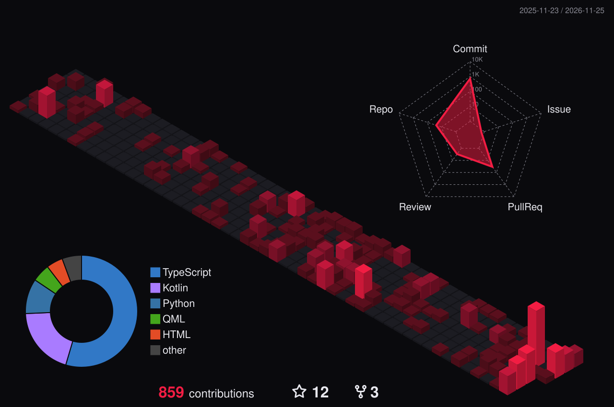

 

 

 

